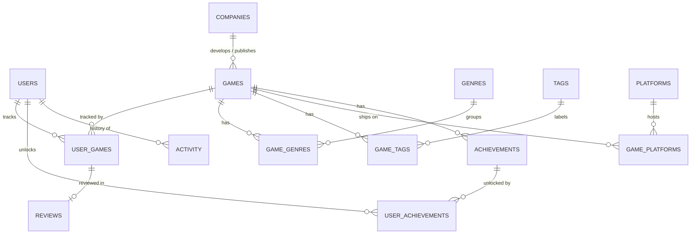

# database/

MySQL schema, seed data and tooling for Geekbond. MySQL 8.0.19+ is required, with InnoDB and utf8mb4 (see [ADR-0001](../docs/adr/0001-database-and-data-access-layer.md)). Every connection runs in strict `sql_mode`, even on the class server whose default is not strict.

**Teammates:** start with [TEAM_README.md](TEAM_README.md). The final ER diagram and the normalization write-up for the report are in [docs/database-report.md](../docs/database-report.md).

```
database/
├── migrations/
│   ├── 001_init.sql                    users, games, genres, game_genres, user_games, view game_stats
│   ├── 002_normalization.sql           companies, platforms, game_platforms, reviews, account columns,
│   │                                   views game_catalog and game_stats (+ review_count)
│   └── 003_integrity_activity_tags.sql CHECK constraints, tags + game_tags, achievements,
│                                       user_achievements, activity, triggers
├── seeds/
│   ├── 001_seed.sql                    15 demo games from the frontend mocks + the demo user's library
│   ├── 002_rawg_games.sql              real games, tags and achievements from RAWG (generated, see below)
│   ├── 003_demo_reviews.sql            3 more demo users, their scores and written reviews
│   └── 004_demo_achievements.sql       demo users unlock a few achievements by name
├── queries.sql                         example queries for the demo and the backend (read-only)
├── cli.ts                              npm run db:status | db:backup | db:migrate | db:seed | db:restore
├── connection.ts                       strict-mode connection, DELIMITER-aware SQL runner
├── sql-files.ts                        migration checksums and SQL splitting (pure)
├── backup.ts                           writes the whole database to one .sql file
├── import-rawg.ts                      npm run db:import-rawg: downloads games from RAWG into seeds/002
└── rawg.ts                             maps RAWG's API data to our tables (pure, unit-tested)
```

## Commands

All of them read `backend/.env` (`DB_HOST`, `DB_PORT`, `DB_USER`, `DB_PASSWORD`, `DB_NAME`), the same settings the API uses.

| Command | What it does |
|---------|--------------|
| `npm run db:status` | Shows the server, user, database, SQL mode, migrations (`[x]` applied, `[!]` edited after applying), row counts and triggers. With `DB_NAME` empty, lists the databases your account can open. |
| `npm run db:backup` | Writes the whole database (tables, rows, views, triggers) to `database/backups/<db>-<time>.sql`. |
| `npm run db:migrate` | Backs up first, then applies every migration not yet in `schema_migrations`. Refuses to run if an applied migration was edited. |
| `npm run db:seed` | Runs every file in `seeds/`. Safe to re-run. |
| `npm run db:restore -- <file> --yes` | Replaces everything in the database with a backup. |
| `npm run db:import-rawg -- --count 150` | Downloads real games from RAWG into `seeds/002_rawg_games.sql`. |

`database/backups/` is git-ignored: backups contain real accounts (emails and password hashes). Never commit one or post it in the group chat. To restore one in MySQL Workbench instead, use Server → Data Import → Import from Self-Contained File.

## Shared group database

The course gives each group **one shared database** on the class MySQL server: ours is `G1`. Every teammate points at it, so data one person adds is visible to everyone. Setup steps for each teammate are in [TEAM_README.md](TEAM_README.md).

**One person** (the database architect) applies schema changes:

```bash
npm run db:migrate
npm run db:seed
```

- `db:migrate` writes a backup before touching anything. If a migration fails part-way, stop and tell the team. MySQL can't undo schema changes (DDL) halfway through a file, so restore the backup it printed (`npm run db:restore -- <file> --yes`) before anyone retries.
- Each applied migration's sha256 checksum is stored in `schema_migrations`. Line endings are ignored, so a Windows checkout matches a Mac one. If someone edits an applied migration, `db:migrate` stops and `db:status` marks it `[!]`. Undo the edit and put the change in a new migration.
- Run `npm test` against a local MySQL first. The database tests apply every migration and seed to throwaway databases.

## Real game data from RAWG

1. Create a free account at <https://rawg.io/apidocs> and copy your API key (32 characters) into `backend/.env` as `RAWG_API_KEY=...`. The key stays on your machine and is never written into the seed.
2. Generate the seed. This defaults to the 100 games most added on RAWG; `--count` takes 1 to 1000:

   ```bash
   npm run db:import-rawg -- --count 150
   ```

3. Load it with `npm run db:seed`, then commit `seeds/002_rawg_games.sql` so teammates get the same data.

What gets imported for each game:

- **Into `games` and the lookup tables:** the title, developer and publisher (into `companies`), the release year, genres (RAWG's 19 only), up to 10 English tags, every platform, the cover image, the description, and the achievement count.
- **Into `achievements`:** the first 20 achievements by name.

RAWG has no install size, so `storage_gb` stays `NULL`.

The importer skips three kinds of games and says why: no release date, no developer, or not on PC, PlayStation 5, Xbox Series X or Nintendo Switch.

It also never changes the 15 demo games from `001_seed.sql`, because the demo users' libraries were written against them. It only adds their achievement lists, which is what `004_demo_achievements.sql` unlocks.

RAWG's terms require crediting RAWG with a link to rawg.io wherever the data is shown (the app's footer does).

## Data model



| Table | Key | Holds |
|-------|-----|-------|
| `users` | `id` | Account: `username` and `email` (both unique), `password_hash` (bcrypt only) |
| `companies` | `id` | Each developer or publisher, stored once by `name` |
| `games` | `id` (slug) | Catalog facts about one game; `developer_id` and `publisher_id` → `companies` |
| `genres` | `id` | RAWG's 19 genres only (CHECK) |
| `tags`, `platforms` | `id` | Lookup lists, unique `name` |
| `game_genres`, `game_tags`, `game_platforms` | (`game_id`, other id) | Many-to-many links |
| `user_games` | (`user_id`, `game_id`) | One user's tracking of one game: status, score, hours, favorite, achievements unlocked, notes |
| `reviews` | (`user_id`, `game_id`) | Public review text; FK → `user_games`, so you can only review a game in your library |
| `achievements` | `id` | A game's achievements by name (from RAWG) |
| `user_achievements` | (`user_id`, `achievement_id`) | Who unlocked which achievement, and when |
| `activity` | `id` | Append-only history of library changes and reviews, written by triggers |
| `game_catalog` (view) | | `games` joined to company names; this is what `GET /api/games` reads |
| `game_stats` (view) | | `average_score`, `popularity`, `review_count`, all computed, never stored |

The normal-form analysis, the functional dependencies, every constraint and trigger, and the design trade-offs are in [docs/database-report.md](../docs/database-report.md).

## For the API (Mauricio)

- **Tags.** `GET /api/games` returns `genres` and `tags`, and `?genre=` matches either one.
- **Achievements.** List a game's achievements from `achievements`. Unlock one with `INSERT INTO user_achievements (user_id, achievement_id)`. The triggers check the game is in the user's library (error 1452 → 409) and update `user_games.achievements_unlocked`.
- **Unlocked count.** `PATCH /api/me/games` with an `achievementsUnlocked` above the game's total fails with error 3819, which the API returns as a 400.
- **Activity.** Read `activity WHERE user_id = ? ORDER BY created_at DESC`. Never write to it from the API: the triggers already do.

## Rules

- **Migrations are numbered `NNN_description.sql` and applied in order.** Never edit one that has been applied anywhere; add the next number instead. The checksum check catches it if you do.
- **Files that define triggers use `DELIMITER $$`**, like the mysql client and Workbench expect. `db:migrate` and `db:seed` understand it too.
- **Validation lives in the schema** (`CHECK`, `ENUM`, foreign keys, triggers), so bad data is rejected no matter which code writes it.
- **Seeds are idempotent** (`ON DUPLICATE KEY UPDATE` / `INSERT IGNORE`), so `npm run db:seed` is always safe to re-run, and a re-run adds no activity history.
- **No real personal data or credentials in this folder.** Demo emails use `example.com`. `tests/security/` fails on database files (`.sqlite`, `.db`) and on passwords.

## Apply to a local MySQL instead

```bash
mysql -u root -e "CREATE DATABASE geekbond"
DB_HOST=127.0.0.1 DB_NAME=geekbond npm run db:migrate
DB_HOST=127.0.0.1 DB_NAME=geekbond npm run db:seed
```

Set every `DB_*` variable you need on the command line. Values from the environment win over `backend/.env`, but anything you leave out still comes from the file.

## Tests

`tests/database/` runs against throwaway databases on a local MySQL server, then drops them. It checks that:

- every migration applies in order, and the constraints and triggers the app relies on hold;
- a database from before 002 and 003, with data in it, upgrades cleanly;
- every seed can be run twice without duplicates or new history;
- `queries.sql` runs and a sample RAWG seed loads;
- `db:migrate`, `db:backup`, `db:restore` and the checksum check work end to end.

The tests skip themselves when MySQL isn't reachable. Connection settings come from `DB_HOST`, `DB_PORT`, `DB_USER` and `DB_PASSWORD`.
