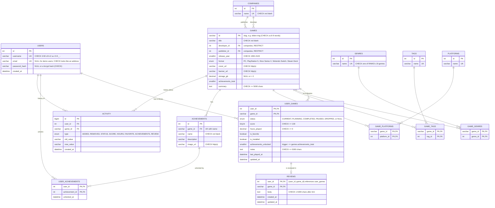

# Geekbond database: design report

**CSE 335, Fall 2026. Database Architect: Amit Sahoo.** This is the database section of the final report: the final ER diagram, the relational schema, the normalization analysis, and how integrity is enforced. Everything described here is in `database/migrations/001`–`003` and runs on the group database `G1`.

## 1. What the database stores

Geekbond is a video game library. Users keep a personal collection of games (status, score, hours played, favorites), write reviews, and track achievements. The catalog comes from the [RAWG Video Games Database](https://rawg.io) plus 15 hand-written demo games.

| Area | Tables |
|------|--------|
| Accounts | `users` |
| Catalog | `games`, `companies`, `genres`, `tags`, `platforms`, `achievements` |
| Catalog links (many-to-many) | `game_genres`, `game_tags`, `game_platforms` |
| A user's data | `user_games`, `reviews`, `user_achievements`, `activity` |
| Computed (views) | `game_catalog`, `game_stats` |
| Bookkeeping | `schema_migrations` |

## 2. ER diagram

Cardinalities in words:

- A user has many library entries (`user_games`); a game appears in many users' libraries. `user_games` is the many-to-many relationship between users and games, with attributes of its own.
- A library entry has at most one review. The review's primary key is also a foreign key to that entry, so a user can only review a game in their library.
- Every game has exactly one developer and one publisher (possibly the same company); a company develops or publishes many games.
- Games and genres, games and tags, and games and platforms are many-to-many.
- A game has many achievements; a user unlocks many achievements, and an achievement is unlocked by many users.

## 3. Relational schema

Primary keys are **bold**, foreign keys are *italic*.

| Relation | Attributes | Other keys and rules |
|----------|------------|----------------------|
| users | **id**, username, email, password_hash, created_at | username UNIQUE, email UNIQUE |
| companies | **id**, name | name UNIQUE |
| games | **id**, title, *developer_id*, *publisher_id*, release_year, format, cover_url, banner_url, storage_gb, achievements_total, summary | developer/publisher → companies ON DELETE RESTRICT |
| genres | **id**, name | name UNIQUE, name ∈ RAWG's genre list |
| tags | **id**, name | name UNIQUE |
| platforms | **id**, name | name UNIQUE |
| game_genres | ***game_id***, ***genre_id*** | both CASCADE |
| game_tags | ***game_id***, ***tag_id*** | both CASCADE |
| game_platforms | ***game_id***, ***platform_id*** | both CASCADE |
| user_games | ***user_id***, ***game_id***, status, score, hours_played, is_favorite, is_installed, achievements_unlocked, notes, last_played_at, updated_at | both CASCADE |
| reviews | ***user_id***, ***game_id***, body, created_at, updated_at | (user_id, game_id) → user_games CASCADE |
| achievements | **id**, *game_id*, name, description, image_url | (game_id, name) UNIQUE; game CASCADE |
| user_achievements | ***user_id***, ***achievement_id***, unlocked_at | both CASCADE |
| activity | **id**, *user_id*, *game_id*, type, old_value, new_value, created_at | both CASCADE |

Views (computed when read, never stored):

- `game_catalog`: `games` joined to `companies`, so each game has `developer` and `publisher` as names. The API's `GET /api/games` reads this.
- `game_stats`: per game, `average_score` (average of `user_games.score`), `popularity` (number of libraries the game is in) and `review_count`.

## 4. Normalization

For each relation, these are the non-trivial functional dependencies (FDs) and the highest normal form it meets. Every relation is in **BCNF**: in every non-trivial FD, the left side is a superkey.

| Relation | Functional dependencies | Candidate keys | Normal form |
|----------|------------------------|----------------|-------------|
| users | id → everything; username → id; email → id | {id}, {username}, {email} | BCNF |
| companies, genres, tags, platforms | id → name; name → id | {id}, {name} | BCNF |
| games | id → title, developer_id, publisher_id, release_year, format, cover_url, banner_url, storage_gb, achievements_total, summary | {id} | BCNF |
| game_genres, game_tags, game_platforms | none besides the trivial ones | the whole row | BCNF |
| user_games | (user_id, game_id) → every other column | {user_id, game_id} | BCNF |
| reviews | (user_id, game_id) → body, created_at, updated_at | {user_id, game_id} | BCNF |
| achievements | id → game_id, name, description, image_url; (game_id, name) → id | {id}, {game_id, name} | BCNF |
| user_achievements | (user_id, achievement_id) → unlocked_at | {user_id, achievement_id} | BCNF |
| activity | id → everything | {id} | BCNF |

### How the design got there

**1NF: every column holds a single value.** Lists live in link tables. The original mock data kept genres as an array per game; `game_genres`, `game_tags` and `game_platforms` hold one row per pair instead of a comma-separated string.

**2NF: no column depends on only part of a composite key.** The tables with two-column keys are the link tables, `user_games`, `reviews` and `user_achievements`:

- In `user_games`, score, status and hours describe the pair (one user's relationship to one game), not the user or the game alone. Catalog facts like the title stay in `games`.
- `user_achievements` deliberately does **not** store `game_id`. The game is determined by `achievement_id` alone (achievement_id → game_id), so storing it in a table keyed on (user_id, achievement_id) would be a partial dependency. The rule this would have made easy ("you can only unlock achievements for games in your library") is enforced by a trigger instead (section 5).

**3NF: no column depends on another non-key column.** Migration 002 fixed the one violation in the first schema. `games.developer` and `games.publisher` repeated company names as text, so "CD PROJEKT RED" appeared on several games. Renaming a company meant updating many rows, and a typo silently split one company into two. Companies are now rows of `companies`, referenced by id.

**BCNF.** The only extra keys are names and pairs that are themselves unique (`username`, `email`, `companies.name`, `achievements(game_id, name)`), so every determinant is a candidate key.

### Derived values are computed, not stored

- `average_score`, `popularity` and `review_count` would go stale the moment a user changes a score, so the `game_stats` view computes them from `user_games` and `reviews` on every read.
- A review stores only its text. Its rating is the reviewer's `user_games.score`, reached through the review's composite foreign key, so a review and the score shown next to it can never disagree.

### Splitting tags from genres (migration 003)

Before 003, `genres` mixed real genres with descriptive labels, giving overlaps like "Action", "Action RPG" and "RPG", or "Shooter" and "FPS". Two problems followed:

- It was unclear what a "genre" was.
- Filters double-counted: a game tagged "Action RPG" was not found under "Action".

Migration 003 splits the data in two:

- `genres` now holds only RAWG's 19 official genres, enforced by a CHECK constraint.
- Every other label moved to `tags`, keeping its links to games.

Labels that imply genres, such as "Action RPG", "FPS", "4X" and "Driving", also give their games the matching genres, so no game lost a genre in the move.

### Deliberate trade-offs

- **`games.format` and `game_platforms`.** The UI shows and filters one main format per game, and `game_platforms` holds every platform the game ships on. They are not redundant: `format` is "the platform this library shows", a fact of its own. The seeds and the RAWG importer also list each game's format in `game_platforms`.
- **`user_games.achievements_unlocked` and `user_achievements`.** The counter is the number a user reports (the UI lets them type it in). `user_achievements` lists the ones we know by name, and RAWG lists at most the first page of a game's achievements. The counter is therefore not derivable from the rows: it can be higher. Triggers keep the two consistent: the counter is never below the named unlocks, and never above the game's total.
- **`games.id` is a slug** (`elden-ring`) rather than a number. It is the same id RAWG uses, so re-importing updates the same row, and URLs stay readable.
- **`activity.old_value` and `new_value` are text.** The history records changes to different kinds of fields (a status name, a score, a number of hours), so it stores the value as it was displayed. It is an append-only log, written only by triggers, so nothing ever updates it, and it has no update anomalies.

## 5. Integrity: what the database enforces on its own

The rules live in the schema, so bad data is rejected whichever code writes it: the API, MySQL Workbench, or a seed.

**Keys and foreign keys.**

- Every relationship above is a foreign key.
- `ON DELETE CASCADE` removes dependent rows (deleting a user removes their library, reviews, unlocks and history).
- `ON DELETE RESTRICT` protects shared rows (a company with games cannot be deleted).

**CHECK constraints** (migrations 001–003):

| Table | Rule |
|-------|------|
| games | slug is lowercase words joined by `-`; title not blank; release year 1950–2100; storage NULL or > 0; image URLs start with `http(s)://`; summary ≤ 5000 chars |
| users | username 3–50 of `A-Z a-z 0-9 _ -` (same as sign-up); email looks like an address; password_hash is NULL or a bcrypt hash, so a plain-text password can never be stored |
| user_games | score ≤ 100; hours ≥ 0; notes ≤ 5000 chars; status is one of five values (ENUM) |
| reviews | body 1–5000 characters after trimming |
| genres | one of RAWG's 19 genres |
| companies, platforms, tags, achievements | name not blank |

**Triggers** (migration 003). These cover rules a CHECK constraint cannot express, because they involve another table:

| Trigger | Rule |
|---------|------|
| `trg_user_games_before_insert` / `_before_update` | `achievements_unlocked` ≤ the game's `achievements_total`, and ≥ the achievements unlocked by name. Raises error 3819, the same as a failed CHECK, so the API answers 400. |
| `trg_games_after_update` | Lowering a game's total, for example on a RAWG re-import, lowers anyone above it to the new total. |
| `trg_user_achievements_before_insert` | An achievement can only be unlocked for a game in the user's library. Raises error 1452, so the API answers 409. |
| `trg_user_achievements_after_insert` | Raises the library counter if the user has now unlocked more by name. |
| `trg_user_games_after_insert` / `_after_update` / `_after_delete`, `trg_reviews_after_insert` / `_after_update` | Write the `activity` history: one row per change to status, score, hours, favorite or achievements, plus additions, removals and reviews. An update that changes nothing writes nothing. Removing a game also removes its unlocked achievements. |

**Strict SQL mode.** The class server's default `sql_mode` is empty, which makes MySQL store bad values with only a warning. For example, a too-long title is cut short, and an unknown ENUM value becomes `''`. The API and every `npm run db:*` command set strict mode on each connection, so those values are rejected instead.

## 6. Operating the shared database

- **Migrations** are numbered SQL files applied in order by `npm run db:migrate`. Each applied file's sha256 checksum is recorded in `schema_migrations`. If a file changes after it was applied, `db:migrate` refuses to run and `db:status` marks it `[!]`, because the database would no longer match the file.
- **Backups.** `db:migrate` writes a full backup before it changes anything, and `npm run db:backup` takes one on demand. `npm run db:restore -- <file> --yes` puts a backup back.
- **Seeds are idempotent** (`ON DUPLICATE KEY UPDATE` / `INSERT IGNORE`), so `npm run db:seed` can be re-run. A re-run does not even add activity history, because no row actually changes.
- **Data source.** Real games come from the RAWG API (`npm run db:import-rawg`), with credit to RAWG shown in the app as its terms require.
